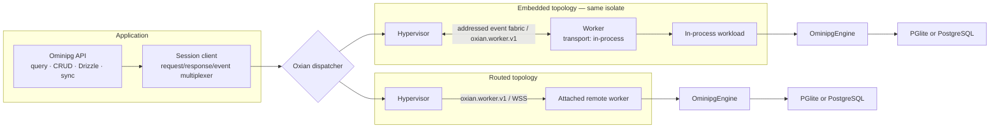
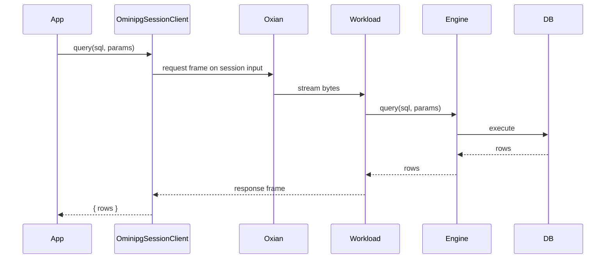

# Architecture

Ominipg is an Oxian-native database workload. The public client, database
engine, and execution topology are separate layers, so the same database API can
run embedded in another application or on a worker attached to an Oxian
Hypervisor.

## Thirty-thousand-foot view



One `Ominipg.connect()` call opens one long-lived `ominipg.session.v1` dispatch.
That dispatch creates one `OminipgEngine`, and the engine owns all mutable state
for the lifetime of the connection. There are no module-level database
singletons.

## Layers

### Public API

`src/client/index.ts` owns the user-facing `Ominipg` class. It provides:

- raw queries and transaction callbacks;
- sync, sequence sync, snapshots, and diagnostics;
- PostgreSQL `LISTEN`/`NOTIFY` subscriptions;
- CRUD helpers and the Drizzle proxy adapter;
- client lifecycle and typed events.

CRUD and Drizzle do not bypass the session. Both compile their operations to SQL
and call the same `Ominipg.query()` method as raw callers.

### Session client

`src/session/client.ts` adapts an Oxian dispatch handle into a stateful client:

- a monotonically increasing request ID correlates responses;
- multiple request promises share one input/output byte stream;
- notification and subscription-state frames are delivered as events;
- request timeouts reject the caller while accepted raw work continues to drain;
  PGlite gates the whole session, while pooled PostgreSQL gates only the
  affected named transaction or default/unlaned request group;
- closing rejects pending requests and closes subscriptions;
- injected dispatchers remain owned by the embedding application.

The accepted dispatcher shape is the minimal Oxian `Dispatcher` contract.
Hypervisors expose that contract directly, and an application can provide
another adapter with the same lifecycle.

### Ominipg session protocol

`src/session/protocol.ts` defines `ominipg.session.v1`. Operations are:

- `initialize`
- `query`
- `sync`
- `sync-sequences`
- `dump-data-dir`
- `diagnostics`
- `listen`
- `unlisten`
- `notify`
- `close`

Every frame has an Ominipg protocol identifier and is one of `request`,
`response`, or `event`. Errors cross the boundary as name, message, and optional
stack fields, then become `Error` objects on the client.

`src/session/codec.ts` is runtime-neutral and handles arbitrary stream chunk
boundaries. A frame contains:

```text
4 bytes  "OMPG"
4 bytes  tagged-JSON header length (uint32, big endian)
4 bytes  binary attachment length (uint32, big endian)
N bytes  UTF-8 tagged JSON
M bytes  raw binary attachments
```

Tagged values preserve `bigint`, `Date`, `Uint8Array`/buffers, `undefined`,
non-finite numbers, and negative zero. Binary values remain raw attachments, so
PGlite snapshots do not pay base64 expansion. Functions, symbols, cyclic values,
and custom object instances are rejected because they are process-local.

The default decoder limit is 512 MiB per frame. A routed client can set
`oxian.maxFrameBytes`; a workload owner can set
`createOminipgWorkload({ maxFrameBytes })`. Oxian can split one Ominipg frame
across any number of transport chunks.

### Workload

`createOminipgWorkload()` returns an Oxian `WorkerWorkHandler`. Each invocation:

1. resolves runtime-owned database providers;
2. creates one `OminipgEngine`;
3. reads framed requests and schedules commands on the engine's supported lanes;
4. writes correlated responses and asynchronous database events;
5. closes engine resources when the client closes, input ends, or the Oxian
   operation is cancelled.

PGlite dispatch awaits each command. PostgreSQL schedules independent commands
concurrently and preserves arrival order within each transaction lane. A named
transaction retains one checked-out client from BEGIN through COMMIT/ROLLBACK.
Transaction and snapshot scheduling keys are tagged tuples, so arbitrary caller
transaction strings cannot collide with snapshot lanes.

Dependencies can be fixed or selected from Oxian metadata:

```ts
createOminipgWorkload({
  dependencies: { pgliteProvider, pgProvider },
  resolveDependencies: async (metadata) => dependenciesFor(metadata.tenantId),
});
```

Fixed dependencies take precedence over provider descriptors sent by the client.
This is the preferred model for remote or multi-runtime workers.

### Engine

`src/worker/engine.ts` is the stateful domain façade. The `src/worker/` name is
retained for package compatibility, but these modules do not install Web Worker
or `worker_threads` listeners.

Every `EngineState` owns:

- the main PGlite adapter or PostgreSQL pool;
- the optional sync pool and logical replication service;
- provider callbacks and PGlite configuration;
- schema metadata and active extensions;
- edge identity, LWW settings, and recently pushed rows;
- sync timers and lifecycle flags;
- notification subscriptions and listener hub.

The engine performs no runtime-global filesystem or memory probing. Optional
host capabilities such as RSS measurement are injected.

## Topologies and ownership

### Private embedded — default

When `oxian` is absent, Ominipg creates a private Hypervisor and an in-process
Worker carrying one workload with capacity one, then dispatches the session
through the Hypervisor. `db.close()` closes the engine, Worker, and Hypervisor.

This path stays inside one JavaScript isolate. Oxian carries encoded control and
binary frames through an addressed event fabric and runs the same handshake,
readiness, heartbeat, lease, acceptance, credit, cancellation, drain, and
shutdown state machines as WebSocket Workers. It creates no socket, Web Worker,
worker thread, or runtime isolate.

### Shared embedded

An application can place a Worker carrying `createOminipgWorkload()` on its own
Hypervisor and pass that Hypervisor as `oxian.dispatcher`. Multiple database
sessions can share the topology while retaining separate engines. `db.close()`
closes only its session; the application owns the shared Worker and Hypervisor.

This is the intended embedding model for a library such as Copilotz: Copilotz
can expose worker-enabled functionality without opening a server or WebSocket.

### Hypervisor-routed

The same workload handler can run in an Oxian worker connected outbound to a
Hypervisor. The server-side application passes that Hypervisor (or an adapter)
as the Ominipg dispatcher. Oxian handles selection, capacity, acceptance,
cancellation, and remote byte-stream transport.

The Ominipg client is not itself a browser-to-Hypervisor requester protocol. A
browser or another remote caller needs an application-owned ingress/bridge to a
process that can dispatch work.

## Database flows

### Query



### Transaction

`Ominipg.transaction()` sends `BEGIN`, invokes the callback, then sends `COMMIT`
or `ROLLBACK`. PGlite already has one backend per engine. The PostgreSQL adapter
checks out a pool client on `BEGIN` and retains it for every session query until
the transaction ends. Closing an engine with an active transaction attempts a
rollback before releasing the connection.

Savepoint rollback (`ROLLBACK [WORK|TRANSACTION] TO [SAVEPOINT] name`) retains
the pinned PostgreSQL client, including when that statement fails. Full
`COMMIT`/`ROLLBACK` and their `END`/`ABORT` aliases release it; `AND CHAIN`
retains it for the next transaction. A failed full ending discards the client
rather than returning a possibly open transaction to the pool. `COMMIT PREPARED`
and `ROLLBACK PREPARED` are distinct from endings of the current lane.
`PREPARE TRANSACTION`, which ends the current transaction, remains outside the
supported managed-lane contract.

Managed transaction control must be a single leading statement in its query. The
adapter recognizes comments and quoted names and refuses control-led
multi-statement batches before sending them. Ordinary schema/function SQL is not
parsed or restricted by this classifier. Transaction control embedded later in
an ordinary raw SQL batch is outside the supported managed-lane contract and
remains unclassified. Broader raw batching would require provider-level
transaction-state observation; this classifier does not provide that guarantee.

The callback executor is valid only while its callback is active. Both `query`
and `queryRaw` refuse retained calls after callback success or failure,
including while the terminal acknowledgement is still pending. Already-admitted
statements are drained before terminal SQL. PGlite and PostgreSQL share this
lifecycle; PGlite serializes whole callbacks, while PostgreSQL uses an
independent pinned lane per callback and can run other queries or transactions
concurrently.

`BEGIN` is covered by cleanup too: a request timeout can conceal a successfully
opened transaction. The existing session gate drains its raw response before a
rollback is sent on the same lane. If rollback fails or cannot be confirmed, the
client refuses further use and closes its workload session. Cleanup bypasses the
public close queue so it cannot wait on its own active transaction. The original
transaction error remains primary; `close()` retains any cleanup failure.

PostgreSQL timeout gating uses the existing pending-request and idle-waiter
state, scoped by the existing transaction lane. A timed-out pool checkout must
not block the named transaction that can release its connection. This includes
ordinary statements before callback completion, not just COMMIT/ROLLBACK. Calls
in the affected lane still wait for their raw responses before starting a new
request deadline. New LISTEN, other non-query and unlaned operations share the
default group. UNLISTEN can remove a subscription using its already-pinned
listener independently, after all accepted work for that subscription drains;
this also preserves a pending LISTEN's order. Unsubscribe does not release the
hub's shared connection; it remains charged until actual hub close/disconnect.
The plain routing envelope is captured before awaiting admission, and encoding
failures install no pending timer or raw waiter. PGlite retains whole-session
serialization. Only the trusted initialized engine concurrency response enables
this distinction. No extra pool, connection budget, fail-fast checkout policy,
lane registry or public API is added.

A timed-out `COMMIT` is still an unknown outcome. Attempting cleanup does not
prove that business writes rolled back, and callers must not blindly replay
them. Timeout rejection is not proof of raw resource release: cleanup can remain
pending while an accepted database request drains.

These guards do not provide distributed snapshot authorization, a reserved pool
budget, database-wide PGlite exclusivity in the presence of background sync, or
snapshot expiry. Those require separate host/backend contracts. A transaction is
session-scoped, not an application-wide lock.

### Internal snapshot connection reservation

PostgreSQL now uses one accounted wrapper around its existing pool. The SQL
adapter and listener hub share that wrapper, so ordinary queries, transaction
BEGIN and LISTEN/reconnect all count. Pending checkouts count too. Ordinary pool
queueing and the configured total connection limit remain unchanged.

The internal `reservePair()` operation admits at most one two-client reservation
and refuses before any BEGIN unless two units fit alongside existing borrows.
The pair is claimed synchronously before either connect can await. While it is
being acquired, normal callers can use the remaining capacity. Once both clients
are held, ordinary calls use the provider's normal queue and cannot take those
reserved clients. No second pool, service, execution lease or new public session
operation is introduced. The provider must honor its configured pool limit and
query/release contracts.

Pair executors seal on release or pool end; already-admitted query promises
drain before both clients are reset with ROLLBACK and returned. A failed reset
discards that client. Failed returns retain their charge and cleanup handle.
Aborted or failed acquisition waits for both raw connect results and returns
late clients; its signal covers admission, while a delivered pair is owned until
release/end. Retained handles refuse new queries. Existing normal clients can
finish their terminal SQL during close; the wrapper preserves their provider's
double-release behavior and captures each checkout's release closure across
client reuse.

Initialization also ends a pool whose connect/probe/release failed before the
engine could retain its adapter. The wrapper does not make arbitrary provider
failures cancellable or prove physical closure from elapsed time.

This is a backend prerequisite. The callback-bound snapshot/control operation,
private PGlite exclusive certification, stable-generation forwarding and owner
snapshot authorization/expiry are not activated by this internal reservation.

### Internal native PGlite snapshot prerequisite

The native PGlite transaction mutex can hold an exclusive read scope without
adding another lock. The internal helper keeps the native transaction private,
seals its query-shaped reader on close/abort, drains admitted raw statements and
explicitly confirms ROLLBACK. Unknown BEGIN or rollback outcome quarantines the
owned database through the caller's fail-close operation. Opening waits for
readonly setup; closing waits for actual cleanup, not an elapsed-time guess.

The adapter lazily compares its actual constructor against the native module
resolved from a recognized built-in Deno/Node descriptor. It captures native
methods and awaits WASM readiness before exposing the real isInTransaction
predicate. The effective configuration is deliberately restricted to primitive
startParams/relaxedDurability inputs; custom extensions and filesystem hooks are
unsupported for this scope. Unsupported providers/configurations retain ordinary
query behavior. There is no new caller isolation flag, provider registry or
literal vendor import in the core dependency graph.

This remains an internal trusted-query primitive, not an arbitrary-SQL sandbox.
Only compiled snapshot reads may use its executor; transaction control,
SET/RESET and other session-changing SQL are forbidden by that caller contract.
READ ONLY cannot confine a caller that deliberately ends its own transaction.

The engine integration below owns resource claim, prior-operation drain, sync
exclusion and actual SQL-idle admission. The helper alone is not that ownership
contract. Generation lifetime and owner authorization remain separate gates.

### Read snapshot resource protocol

The internal session protocol now supports snapshot-open, snapshot-query and
snapshot-close with a bounded caller-created snapshotId. At most one resource is
active per engine. Opening acknowledges after actual transaction/setup
readiness; it does not wait for the whole native callback, so subsequent PGlite
frames can make progress. Queries remain trusted SQL from the database client,
not untrusted worker Collection input.

PGlite claims admission synchronously, drains previously accepted ordinary
operations, rejects sync mode, obtains the certified native provider and checks
actual transaction-idle state. Ordinary engine commands refuse while the scope
is live. PostgreSQL reserves its accounted pair and exposes independent snapshot
and current-state query lanes; current transactions use the second reserved
client. Ordinary queued checkouts cannot block those lanes or their close.

Close seals new scoped reads, drains admitted raw work and releases the
resource. A result completed after resource revocation is not returned. Partial
acquisition with an unconfirmed client return is distinguished by an internal
cleanup-error class and quarantines engine admission; confirmed acquisition
failure or capacity refusal leaves ordinary usage available. Terminal cleanup
failure survives record removal and remains observable through later
snapshot-close/engine-close, even when physical shutdown itself subsequently
succeeds.

Graceful transport close and EOF first seal future snapshot admission and
release snapshot pins, then drain already-accepted ordinary lane commands, then
close the engine. This avoids both a pin/checkout shutdown deadlock and
rejecting queued legacy UPDATE/COMMIT work merely because a close frame arrived.
Host cancellation uses the engine's direct abort/close path. Unknown cleanup is
never interpreted as free capacity or permission to replay an operation.

These backend resources and frames support the callback capability below.
Managed-generation forwarding and owner historical-read authorization/expiry
remain separate integration gates.

### Callback snapshot capability

Ominipg.withReadSnapshot(callback, { signal }) admits one scope per database
instance. The workload must advertise snapshotProtocol: 1; older workloads
refuse this capability rather than silently substituting ordinary reads. The
returned scope has kind: "exclusive" or kind: "pooled" and a snapshot
query/queryRaw executor. Pooled scopes also provide current(callback), which
serializes transactions on the already-reserved control connection.

The callback's return value is local computation. Query handles seal at scope
end, and actual request/transaction cleanup finishes before the method settles.
Signal cancellation and database close abort the scope, including a held local
callback, without treating that local computation as forcibly terminated.
Detached callback code can still run, but retained executors refuse further
work. A late abort before cleanup completes suppresses the callback result.

Current-state transactions reuse the same scoped transaction lifecycle as normal
database transactions, including executor sealing, raw request drain and
uncertain rollback fail-close. No separate transaction evaluator is added.
Concurrent current calls serialize; do not nest current inside its own callback.
Nested/concurrent snapshot scopes on one instance refuse immediately.

Only trusted compiled read SQL belongs on the snapshot executor. Do not send
transaction-control or session-changing SQL through it. Use the supplied
executors inside callbacks: awaiting ordinary PGlite database operations there
would wait behind the scope itself. Cancellation is not proof that previously
admitted SQL or COMMIT did not execute, and does not authorize callback replay.

The capability is also forwarded by the Drizzle mixin. It is a backend API;
Copilotz generation fencing and public owner Collection snapshot authorization
remain separate work.

### Sync

Sync belongs to the engine session:

1. bootstrap creates user schema and sync infrastructure;
2. initial synchronization reconciles local and remote data;
3. logical replication pulls remote changes when configured;
4. local triggers track changes;
5. `sync()` pushes a batch to PostgreSQL;
6. edge identity and the configured LWW column suppress echoes and resolve
   supported conflicts.

Session shutdown stops replication and timers before closing database pools.

### Notifications

PostgreSQL notifications are asynchronous session events. The first `listen()`
creates one listener hub and pins one pool connection; channels and callbacks
are multiplexed over it. Connection failure enters `reconnecting`, then active
channels are reissued with capped backoff. `pgPoolMax` must be at least two.

PGlite and sync-only notification use is rejected. Notifications remain
best-effort wake-up signals; durable state belongs in tables.

## Runtime boundary

The public dependency closure uses `crypto`, Web Streams, typed arrays,
`TextEncoder`/`TextDecoder`, `Blob`, timers, and promises. It contains no direct
Deno, Node, Bun, Cloudflare, Web Worker, `postMessage`, or `worker_threads` API.

Database providers are capability boundaries. A runtime-neutral session does not
make every database engine available in every runtime: filesystem-backed PGlite
needs filesystem support, and PostgreSQL/logical replication need a compatible
driver and network model.

## Design consequences

- Embedded execution is lighter than loopback WebSocket execution, but slightly
  heavier than a direct method call because it preserves the unified framed
  session contract.
- Same-isolate execution provides lifecycle, scheduling, cancellation, and
  ownership—not CPU, memory, crash, or security isolation.
- Streams are the data plane because they carry backpressure and cancellation;
  JavaScript callbacks/events are used only for local observation.
- One long-lived dispatch preserves connection, transaction, subscription, and
  sync state naturally.
- Explicit providers keep runtime-specific imports out of the core and make
  worker runtime ownership visible.
- An injected dispatcher or Hypervisor always outlives individual Ominipg
  sessions unless its application owner shuts it down.

## Related documentation

- [Oxian embedding and routing](./OXIAN.md)
- [Runtime support](./RUNTIMES.md)
- [Migrating to 0.9](./MIGRATION_0_9.md)
- [Sync](./SYNC.md)
- [PostgreSQL notifications](./NOTIFICATIONS.md)

### Snapshot cleanup outcome

The optional `withReadSnapshot` cleanup observer receives `confirmed` or
`unknown`, independently of the callback's returned value or thrown error.
Confirmation means this invocation submitted no snapshot open, or its exact
snapshot-close acknowledgement succeeded after admitted work drained. A failed
reset followed by a confirmed client discard is still confirmed cleanup.
Unconfirmed return/close remains unknown; error text, error classes and callback
entry alone do not establish release.

The observer is captured once and called once after controller/listener cleanup.
Observer exceptions or rejected observer promises do not replace the original
scope outcome. Cancellation is checked again before exposing a successful value.
Consumers must wait for the actual scoped operation to settle as well as record
the observation; missing observation is unknown. This proves release of this
scope only, never current application authority, safe mutation replay, or global
database shutdown. No wire operation or additional resource registry is added.
